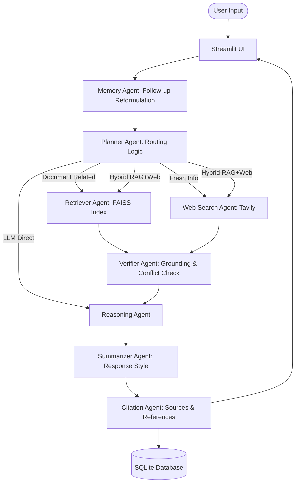

# 🤖 Multi-Agent Research Assistant

An enterprise-grade, production-ready **Multi-Agent Research Assistant** built with **LangGraph**, **LangChain**, **Ollama (llama3.1)**, **FAISS**, **SQLite**, **Streamlit**, and **Tavily Web Search API**.

It combines document-based RAG, real-time web search, intelligent query routing, answer verification, citations, and conversational memory to deliver context-aware research with PDF, DOCX, and Markdown export.

Unlike simple RAG chatbots, this application employs a **Planner Agent** to dynamically analyze query intent, uploaded document availability, retrieval confidence scores, and freshness requirements to route queries along optimal agent execution paths.

---

## 🌟 Key Features

- **8 Autonomous Specialized Agents**:
  1. 🧠 **Planner Agent**: Analyzes user intent, document presence, and freshness to dynamically route execution.
  2. 📚 **Retriever Agent**: Parses PDF, DOCX, and TXT files, splits text into chunks, generates embeddings with HuggingFace (`sentence-transformers/all-MiniLM-L6-v2`), and indexes into FAISS vector store with normalized confidence scores.
  3. 🌐 **Web Search Agent**: Executes real-time web searches using Tavily API when external or live data is required.
  4. 💡 **Reasoning Agent**: Synthesizes facts across uploaded documents, web search snippets, and LLM reasoning into grounded answers.
  5. 🔍 **Verifier Agent**: Validates retrieval confidence, checks grounding, detects document vs. web search conflicts, and flags outdated documents.
  6. ✍️ **Summarizer Agent**: Formats responses into selectable styles (`Brief`, `Detailed`, `Bullet Points`, `ELI5`, `Professional`, `Research`).
  7. 📌 **Citation Agent**: Automatically formats and attaches exact inline and footer citations for uploaded files (filename & page number) and web URLs.
  8. 🧠 **Memory Agent**: Manages SQLite conversation history and reformulates follow-up queries for context awareness.

- **Dynamic Execution Routing**:
  - `llm_only`: General knowledge, programming, or coding questions.
  - `rag_only`: Questions strictly pertaining to uploaded documents.
  - `web_search`: Latest/current news, real-time events, external facts.
  - `hybrid_rag_llm`: Related to uploaded documents, but augmented with LLM reasoning when document facts are partial.
  - `hybrid_rag_web`: Comparing uploaded document facts with latest live web research.

- **Enterprise Streamlit Interface**:
  - Dark mode glassmorphic UI.
  - Dynamic route badges & retrieval confidence percentage indicators.
  - Expandable agent execution steps.
  - Multiple document uploader & vector DB status dashboard.
  - Export chat history as **PDF**, **DOCX**, or **Markdown**.

---

## 🏗️ Architecture & Workflow



---

## 📁 Directory Structure

```
multi-agent-research-assistant/
│
├── app.py                      # Main Streamlit UI dashboard
├── graph.py                    # LangGraph StateGraph orchestration
├── config.py                   # Centralized configuration & environment loader
├── database.py                 # SQLite database for persistent history & metadata
├── prompts.py                  # System & user prompts for all 8 agents
├── utils.py                    # Logging setup and PDF/DOCX/MD export utilities
│
├── agents/                     # Modular Agent Implementations
│   ├── __init__.py
│   ├── planner.py              # Query intent & routing agent
│   ├── retriever.py            # PDF/DOCX/TXT loader & FAISS vector search agent
│   ├── web_search.py           # Tavily web search agent
│   ├── reasoning.py            # Multi-source answer synthesis agent
│   ├── verifier.py             # Groundedness & conflict verification agent
│   ├── summarizer.py           # Multi-style formatting agent
│   ├── citation.py             # Citation extraction agent
│   └── memory.py               # History & follow-up reformulation agent
│
├── uploads/                    # Directory for uploaded documents
├── vector_store/               # FAISS vector store index directory
├── database/                   # SQLite database location
├── logs/                       # Application logs directory
├── sample_docs/                # Test documents for quick RAG testing
├── requirements.txt            # Python dependencies
├── README.md                   # Documentation
└── .env.example                # Sample environment variables
```

---

## ⚡ Quick Start & Installation

### 1. Prerequisites
- Python 3.10+
- (Optional) [Ollama](https://ollama.com/) with `llama3.1` pulled:
  ```bash
  ollama pull llama3.1
  ```

### 2. Create & Activate Virtual Environment

**Windows (PowerShell):**
```powershell
python -m venv .venv
.\.venv\Scripts\Activate.ps1
```

**Windows (CMD):**
```cmd
python -m venv .venv
.\.venv\Scripts\Activate.ps1
```

**Linux / macOS:**
```bash
python -m venv .venv
source .venv/bin/activate
```

### 3. Install Dependencies
```bash
pip install -r requirements.txt
```

> **Note**: Always run from inside the activated `.venv` environment. If you see `ModuleNotFoundError`, ensure `.venv` is activated or use the full path to `.venv\Scripts\python.exe -m streamlit run app.py`.

### 4. Configure Environment Variables
Copy `.env.example` to `.env`:
```bash
cp .env.example .env   # Linux/macOS
copy .env.example .env  # Windows
```
Update `.env` with your Tavily API Key (or OpenAI key if using fallback):
```env
OLLAMA_BASE_URL=http://localhost:11434
OLLAMA_MODEL=llama3.1
TAVILY_API_KEY=your_tavily_api_key_here
```

### 5. Run the Streamlit Application

**After activating `.venv`:**
```bash

```

**Or directly with venv Python (no activation needed):**
```powershell
# Windows
.\.venv\Scripts\python.exe -m streamlit run app.py
```
```bash
# Linux/macOS
.venv/bin/python -m streamlit run app.py
```

---

## 🧪 Testing the Assistant

1. **General Knowledge / Coding (LLM Only)**:
   - Ask: `"What is LangChain?"` or `"Write a Python function to quicksort an array."`
   - Route Badge: `ROUTE: LLM_ONLY`

2. **RAG Document Search**:
   - Upload `sample_docs/sample_research.txt` in the sidebar and click **Process & Index Documents**.
   - Ask: `"What is Project Titan and what is its latency benchmark?"`
   - Route Badge: `ROUTE: RAG_ONLY` or `ROUTE: HYBRID_RAG_LLM` with document citations.

3. **Web Search**:
   - Ask: `"What are the latest updates on GPT-5?"`
   - Route Badge: `ROUTE: WEB_SEARCH` with web source links.

4. **Follow-up Conversation**:
   - Ask: `"Explain LangGraph."`
   - Follow up: `"Compare it with CrewAI."`
   - Memory Agent automatically reformulates query context.

5. **Conversation Export**:
   - Click **PDF**, **DOCX**, or **MD** buttons in the sidebar to download conversation logs.

---

## 📝 License
MIT License. Built for enterprise Agentic AI development.
